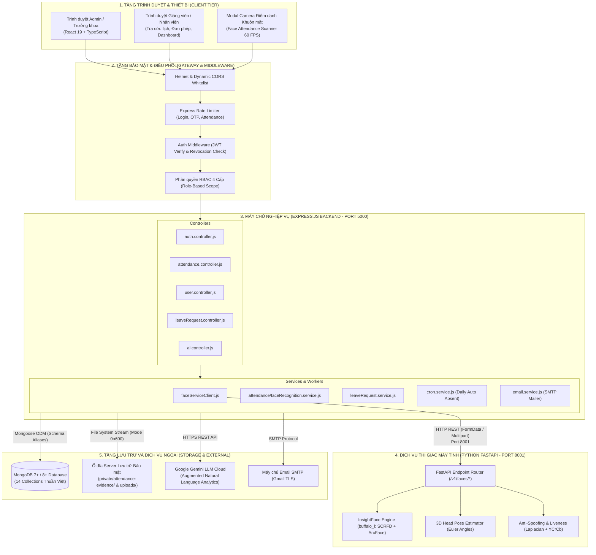
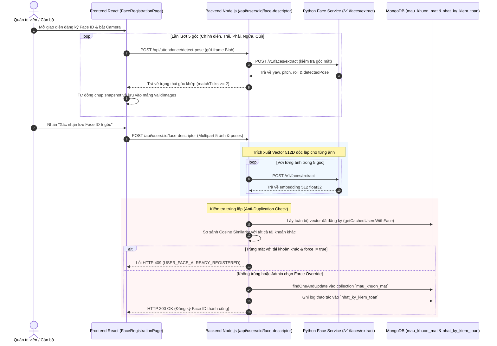

# 🎓 DATN_QLNS_ChamCong_FaceRec: HỆ THỐNG QUẢN LÝ NHÂN SỰ VÀ CHẤM CÔNG ỨNG DỤNG THỊ GIÁC MÁY TÍNH

> **Đề tài tốt nghiệp:** Xây dựng hệ thống quản lý nhân sự và chấm công ứng dụng thị giác máy tính  
> **Sinh viên thực hiện:** Vũ Tiến Đức — **Mã sinh viên:** 2310900023  
> **Repository:** [https://github.com/Vu-Tien-Duc/DATN_QLNS_ChamCong_FaceRec](https://github.com/Vu-Tien-Duc/DATN_QLNS_ChamCong_FaceRec)  
> **Loại tài liệu:** Tài liệu kỹ thuật chính thức và đặc tả kiến trúc mã nguồn (Audited Technical Specification)  
> **LƯU Ý QUAN TRỌNG:** Bản đặc tả kiến trúc CSDL 14 Collections và toàn bộ quy trình nghiệp vụ chốt của đồ án được quy định tập trung, duy nhất tại: [THIET_KE_CSDL_VA_QUY_TRINH_NGHIEP_VU.md](THIET_KE_CSDL_VA_QUY_TRINH_NGHIEP_VU.md). Mọi triển khai mã nguồn đều tuân thủ 100% tài liệu này.

---

## 📑 MỤC LỤC TỔNG QUAN

1. [Tổng quan Đề tài và Phạm vi Hệ thống](#1-tổng-quan-đề-tài-và-phạm-vi-hệ-thống)
2. [Kiến trúc Tổng thể và Công nghệ Sử dụng](#2-kiến-trúc-tổng-thể-và-công-nghệ-sử-dụng)
3. [Cấu trúc Thư mục Dự án](#3-cấu-trúc-thư-mục-dự-án)
4. [Mô hình Dữ liệu MongoDB (14 Collections - Chuẩn v2.6)](#4-mô-hình-dữ-liệu-mongodb-14-collections---chuẩn-v26)
5. [Sơ đồ Quan hệ Thực thể (Mermaid ERD)](#5-sơ-đồ-quan-hệ-thực-thể-mermaid-erd)
6. [Phân tích Chuyên sâu Hệ thống Nhận diện Khuôn mặt](#6-phân-tích-chuyên-sâu-hệ-thống-nhận-diện-khuôn-mặt)
   - 6.1. [Quy trình Đăng ký Khuôn mặt Đa góc](#61-quy-trình-đăng-ký-khuôn-mặt-đa-góc)
   - 6.2. [Đặc tính Kỹ thuật Vector Khuôn mặt (512 Chiều)](#62-đặc-tính-kỹ-thuật-vector-khuôn-mặt-512-chiều)
   - 6.3. [Phân tích Chi tiết Vector 5 Góc Khuôn mặt](#63-phân-tích-chi-tiết-vector-5-góc-khuôn-mặt)
   - 6.4. [Phân tích Vị trí Lưu trữ Ảnh Đăng ký và Ảnh Chấm công](#64-phân-tích-vị-trí-lưu-trữ-ảnh-đăng-ký-và-ảnh-chấm-công)
   - 6.5. [Quy trình Chấm công Đầu - Cuối (Face Check-In Pipeline)](#65-quy-trình-chấm-công-đầu---cuối-face-check-in-pipeline)
7. [Các Luồng Nghiệp vụ Cốt lõi](#7-các-luồng-nghiệp-vụ-cốt-lõi)
   - 7.1. [Xác thực, Cấp phát Token và Bảo mật Phiên](#71-xác-thực-cấp-phát-token-và-bảo-mật-phiên)
   - 7.2. [Cơ cấu Tổ chức, Phân cấp Khoa/Bộ môn và Phạm vi Quản lý (Dean Scope)](#72-cơ-cấu-tổ-chức-phân-cấp-khoabộ-môn-và-phạm-vi-quản-lý-dean-scope)
   - 7.3. [Quản lý Ca làm việc, Môn học và Xếp lịch Giảng dạy](#73-quản-lý-ca-làm-việc-môn-học-và-xếp-lịch-giảng-dạy)
   - 7.4. [Quản lý Đơn Nghỉ phép, Dạy bù và Trừ Quỹ phép](#74-quản-lý-đơn-nghỉ-phép-dạy-bù-và-trừ-quỹ-phép)
   - 7.5. [Báo cáo Thống kê và Xuất Dữ liệu Excel](#75-báo-cáo-thống-kê-và-xuất-dữ-liệu-excel)
   - 7.6. [Trợ lý Ảo AI Assistant (Augmented Analytics & LLM)](#76-trợ-lý-ảo-ai-assistant-augmented-analytics--llm)
   - 7.7. [Nhật ký Kiểm toán Hệ thống Bất biến (Append-Only Audit Log)](#77-nhật-ký-kiểm-toán-hệ-thống-bất-biến-append-only-audit-log)
8. [Danh mục API Chi tiết (RESTful Endpoints)](#8-danh-mục-api-chi-tiết-restful-endpoints)
9. [Cấu trúc Frontend và Phân hệ Giao diện](#9-cấu-trúc-frontend-và-phân-hệ-giao-diện)
10. [Hướng dẫn Cài đặt, Cấu hình và Khởi chạy](#10-hướng-dẫn-cài-đặt-cấu-hình-và-khởi-chạy)
11. [Bảo mật Hệ thống và Tuân thủ Dữ liệu Sinh trắc học](#11-bảo-mật-hệ-thống-và-tuân-thủ-dữ-liệu-sinh-trắc-học)
12. [Kết quả Kiểm thử Tự động và Đánh giá Thực nghiệm](#12-kết-quả-kiểm-thử-tự-động-và-đánh-giá-thực-nghiệm)
13. [Hạn chế Hiện tại và Lộ trình Phát triển](#13-hạn-chế-hiện-tại-và-lộ-trình-phát-triển)
14. [Bằng chứng Triển khai và Truy vết Mã nguồn (Traceability Matrix)](#14-bằng-chứng-triển-khai-và-truy-vết-mã-nguồn-traceability-matrix)
15. [Thuật ngữ Kỹ thuật (Glossary)](#15-thuật-ngữ-kỹ-thuật-glossary)

---

## 1. TỔNG QUAN ĐỀ TÀI VÀ PHẠM VI HỆ THỐNG

### 1.1. Bối cảnh và Vấn đề Giải quyết
Trong các cơ sở giáo dục đại học và cơ quan doanh nghiệp, việc quản lý thời gian làm việc, lịch giảng dạy và giải quyết đơn từ hành chính của cán bộ, giảng viên, nhân viên đối mặt với nhiều thách thức:
1. **Gian lận chấm công**: Điểm danh hộ qua thẻ từ, chia sẻ tài khoản hoặc dùng ảnh tĩnh/video để qua mặt camera chấm công thông thường.
2. **Thiếu sự tách bạch dữ liệu**: Nhiều hệ thống chỉ lưu một bản ghi check-in/check-out duy nhất, làm mất toàn bộ vết quét thô (raw punches), không có bằng chứng đối soát khi có tranh chấp giờ công.
3. **Phân cấp quản lý chồng chéo**: Chưa phân định rõ ranh giới thẩm quyền giữa Ban Giám hiệu (toàn trường), Trưởng khoa/Viện trưởng (theo khoa) và Giảng viên (cá nhân).
4. **Quy trình hành chính thủ công**: Đơn xin nghỉ phép, xin dạy bù, đổi ca xử lý trên giấy tờ rời rạc, không liên thông tự động với lịch trình giảng dạy và bảng công thực tế.

Hệ thống **DATN_QLNS_ChamCong_FaceRec** được thiết kế và triển khai nhằm giải quyết toàn diện các vấn đề trên thông qua sự kết hợp giữa kiến trúc phần mềm hướng dịch vụ phân tầng và công nghệ Thị giác máy tính (Computer Vision) hiện đại.

### 1.2. Đối tượng và Phạm vi Phục vụ
- **Đối tượng quản lý của hệ thống:**
  - Cán bộ quản trị cấp trường (`admin`).
  - Trưởng khoa, Trưởng viện, Trưởng đơn vị (`truongkhoa`).
  - Cán bộ giảng viên cơ hữu và thỉnh giảng (`giangvien`).
  - Chuyên viên, nhân viên khối hành chính (`nhanvien`).
- **Lý do không đưa Sinh viên vào cơ sở dữ liệu nhân sự:**
  - Tên đề tài là: *"Quản lý nhân sự và chấm công"*. Sinh viên là người học (khách hàng đào tạo), không có hợp đồng lao động, không hưởng lương hay quota nghỉ phép năm theo quy định của Luật Lao động.
  - Việc đưa sinh viên vào cùng bảng `nguoi_dung` sẽ làm vỡ tính toàn vẹn dữ liệu (hàng loạt trường chức vụ, mã cán bộ, hợp đồng, số ngày phép sẽ bị rỗng).
  - Phân hệ điểm danh sinh viên được xác định nằm trong **Mục tiêu mở rộng (Future Scope)** thông qua việc tích hợp bảng sinh viên và lớp học phần độc lập với mô hình nhân sự.

---

## 2. KIẾN TRÚC TỔNG THỂ VÀ CÔNG NGHỆ SỬ DỤNG

### 2.1. Ngăn xếp Công nghệ (Tech Stack)

| Tầng kiến trúc | Công nghệ / Thư viện | Phiên bản | Vai trò & Mục đích trong dự án |
| :--- | :--- | :--- | :--- |
| **Frontend Client** | React + TypeScript | React 19.2.8, TS 6.0.2 | Xây dựng giao diện Web SPA và Camera Điểm danh Khuôn mặt reactive, type-safe |
| **Bundler & Build Tool**| Vite | 8.3.0 | Môi trường phát triển HMR siêu tốc và đóng gói bundle tối ưu |
| **CSS & Design System** | TailwindCSS + Lucide Icons | Tailwind 3.4.17 | Thiết kế giao diện hiện đại, Dashboard trực quan, chuẩn UI/UX |
| **Backend Core** | Node.js + Express.js | Express 5.2.1, Node 20+ | RESTful API Gateway, xác thực RBAC, định tuyến và xử lý nghiệp vụ |
| **Database ODM** | MongoDB + Mongoose | Mongoose 9.9.4 | Quản lý CSDL NoSQL, Indexing, Virtuals, Aggregation Pipelines |
| **Face AI Service** | Python + FastAPI + Uvicorn | FastAPI 0.115.6, Py 3.12 | Microservice AI trích xuất embedding, 3D Pose và Liveness |
| **Face AI Models** | InsightFace (`buffalo_l`) | InsightFace 0.7.3, ONNX 1.20 | Mô hình SCRFD phát hiện mặt + ArcFace (ResNet-50) 512-D |
| **Computer Vision** | OpenCV Headless + NumPy | OpenCV 4.10, NumPy 1.26 | Xử lý ảnh ma trận, Laplacian variance, Euler angles, YCrCb chroma |
| **Bảo mật & Mã hóa** | JWT + bcryptjs + Helmet | jsonwebtoken 9.0, bcryptjs 3.0 | Mã hóa mật khẩu, quản lý Access/Refresh Token, bảo vệ HTTP headers |
| **Tác vụ nền (Cron)** | node-cron | 3.0.3 | Quét tự động chốt công, phát hiện vắng mặt cuối ngày (`ABSENT`) |
| **Email Service** | Nodemailer | 10.0.3 | Gửi thông báo phê duyệt đơn phép, cảnh báo chấm công |
| **Xử lý File & Excel** | Multer + SheetJS (`xlsx`) | Multer 2.4, xlsx 0.18.5 | Tải ảnh/tài liệu đính kèm, xuất bảng công động và bảng lương ra Excel |
| **AI LLM Multi-Provider** | Gemini, Claude, DeepSeek, Local Ollama | REST / SDK | Trợ lý hỏi đáp quy chế nhà trường 2026, tra cứu công và lương tự nhiên |
| **Tài liệu API** | Swagger UI + OpenAPI 3.0 | swagger-ui-express | Tài liệu hóa tập trung 26 endpoints RESTful tại `/api-docs` |
| **Container Hóa** | Docker + Docker Compose | Compose v2 | Đóng gói 3 dịch vụ: Web Multi-stage, Python Face AI, Mongo Replica Set |

### 2.2. Sơ đồ Kiến trúc Tổng thể Hệ thống (System Architecture)



---

## 3. CẤU TRÚC THƯ MỤC DỰ ÁN

Dự án được cấu trúc theo mô hình **Fullstack Đơn rễ (Single-Root Workspace)**:

```text
DATN_QLNS_ChamCong_FaceRec/
├── package.json                         # Khai báo cấu hình npm, scripts và toàn bộ dependencies
├── vite.config.ts                       # Cấu hình Vite Bundler, Proxy /api sang backend port 5000
├── tailwind.config.js                   # Cấu hình TailwindCSS
├── tsconfig.json                        # Cấu hình TypeScript cơ sở
├── .env.example                         # Biến môi trường mẫu
│
├── face-service/                        # DỊCH VỤ PYTHON THỊ GIÁC MÁY TÍNH (FASTAPI MICROSERVICE)
│   ├── app.py                           # FastAPI server: trích xuất vector 512D, 3D Pose, Liveness
│   ├── requirements.txt                 # Khai báo thư viện: insightface, onnxruntime, opencv, fastapi
│   └── README.md                        # Hướng dẫn môi trường ảo Python 3.12 và tải model buffalo_l
│
├── server/                              # MÃ NGUỒN BACKEND (NODE.JS / EXPRESS.JS)
│   ├── server.js                        # Điểm khởi chạy máy chủ HTTP và lắng nghe cổng PORT
│   ├── app.js                           # Cấu hình Express, CORS, Helmet, Swagger, Routes, Static
│   ├── config/                          # Cấu hình hệ thống
│   │   ├── db.js                        # Kết nối MongoDB qua Mongoose ODM
│   │   ├── env.js                       # Hàm kiểm tra và validate biến môi trường khi khởi động
│   │   ├── mailer.js                    # Cấu hình Nodemailer transporter (Gmail SMTP)
│   │   └── swagger.js                   # Cấu hình sinh tài liệu API OpenAPI / Swagger UI
│   ├── controllers/                     # Bộ điều khiển tiếp nhận và xử lý HTTP Request (13 controllers)
│   │   ├── attendance.controller.js     # Chấm công Face ID, GPS, duyệt công và quản lý evidence
│   │   ├── auth.controller.js           # Đăng nhập, refresh token, đổi mật khẩu, OTP
│   │   ├── user.controller.js           # Quản lý hồ sơ cán bộ, đăng ký vector khuôn mặt
│   │   ├── department.controller.js     # Quản lý cây phòng ban / khoa / bộ môn
│   │   ├── leaveRequest.controller.js   # Tiếp nhận và phê duyệt đơn nghỉ phép, tính quota
│   │   ├── schedule.controller.js       # Phân công lịch dạy, kiểm tra xung đột phòng/giờ
│   │   ├── shiftConfig.controller.js    # Cấu hình ca làm việc, ngưỡng tính đi muộn/về sớm
│   │   ├── subject.controller.js        # Quản lý danh mục môn học
│   │   ├── auditLog.controller.js       # Truy vấn nhật ký kiểm toán hệ thống
│   │   ├── report.controller.js         # Tổng hợp dữ liệu chấm công và xuất file Excel
│   │   ├── ai.controller.js             # Xử lý trợ lý ảo AI hỏi đáp ngôn ngữ tự nhiên
│   │   ├── notification.controller.js   # Danh sách thông báo cá nhân
│   │   └── upload.controller.js         # Tiếp nhận và phân quyền tải file minh chứng / avatar
│   ├── middlewares/                     # Bộ lọc trung gian HTTP
│   │   ├── auth.middleware.js           # Xác thực JWT, thu hồi Token & RBAC
│   │   ├── error.middleware.js          # Bắt và chuẩn hóa mã lỗi hệ thống tập trung
│   │   ├── rateLimiter.middleware.js    # Chống tấn công brute-force vào API Login, OTP, Attendance
│   │   └── upload.middleware.js         # Multer cấu hình lưu trữ bộ nhớ và đĩa
│   ├── models/                          # 14 Mongoose Models (CSDL thuần Việt + Aliases tiếng Anh chuẩn v2.6)
│   │   ├── index.js                     # Barrel export đồng thời cả 2 chuẩn tên (Anh & Việt)
│   │   ├── user.model.js                # Collection 1: nguoi_dung (10 vai trò đại học, nhiệm kỳ, Face ID flag)
│   │   ├── faceTemplate.model.js        # Collection 2: mau_khuon_mat (512D ArcFace, 5 góc, L2 Centroid)
│   │   ├── department.model.js          # Collection 3: don_vi / phong_ban (Cây cơ cấu Khoa/Viện/Bộ môn)
│   │   ├── shiftConfig.model.js         # Collection 4: ca_lam_viec (Khung giờ, buffer, hệ số)
│   │   ├── subject.model.js             # Collection 5: mon_hoc (Mã môn, tín chỉ, lý thuyết/thực hành)
│   │   ├── schedule.model.js            # Collection 6: lich_giang_day / lich_trinh (TKB học kỳ, dạy bù, ngoại lệ)
│   │   ├── holiday.model.js             # Collection 7: ngay_nghi_le (Danh mục ngày nghỉ lễ toàn trường)
│   │   ├── punchLog.model.js            # Collection 8: luot_quet_cham_cong / luot_quet (Raw punches, GeoJSON GPS)
│   │   ├── attendanceLog.model.js       # Collection 9: nhat_ky_cham_cong (Bản ghi nhật ký chấm công)
│   │   ├── leaveRequest.model.js        # Collection 10: don_tu / don_nghi_phep (Duyệt đa cấp, khóa lạc quan 409)
│   │   ├── payroll.model.js             # Collection 11: phieu_luong (Bảng lương 2026, thuế 5 bậc, isLocked)
│   │   ├── refreshToken.model.js        # Collection 12: ma_lam_moi (Token Rotation, Grace Period 15s, TTL 30 ngày)
│   │   ├── systemConfig.model.js        # Collection 13: cau_hinh_he_thong (19 tham số nghiệp vụ động toàn trường)
│   │   └── auditLog.model.js            # Collection 14: nhat_ky_kiem_toan (Append-Only bất biến, 403 khi sửa/xóa)
│   ├── routes/                          # Định tuyến API (Đầy đủ 14 phân hệ)
│   │   ├── index.js                     # Gắn các route con với tiền tố /api và /api/v1
│   │   └── *.routes.js                  # 14 file route tương ứng với từng phân hệ
│   ├── services/                        # Tầng xử lý nghiệp vụ độc lập
│   │   ├── faceServiceClient.js         # HTTP Client gọi sang Python Face Service (Port 8001, Auto Self-Healing)
│   │   ├── faceTemplate.service.js      # Xử lý đăng ký mẫu mặt 5 góc, kiểm tra trùng lặp L2 norm
│   │   ├── attendance/                  # 8 modules phân rã nghiệp vụ chấm công (Check-in, Check-out, QR, GPS...)
│   │   ├── ai/                          # Đa mô hình LLM Router (Gemini, Claude, DeepSeek, Local Ollama) & Quy chế 2026
│   │   ├── auth.service.js              # Nghiệp vụ xác thực, Token Rotation Grace Period 15s & In-Memory Revocation
│   │   ├── cron.service.js              # Tác vụ nền đánh vắng tự động, xử lý quên quẹt ra, catch-up khi restart
│   │   ├── email.service.js             # Soạn và gửi mail thông báo chấm công, báo cáo cuối ngày
│   │   ├── leaveRequest.service.js      # Duyệt đa cấp Khoa -> BGH, chặn tự duyệt, hồi tố và hoàn tác công ACID
│   │   ├── payroll.service.js           # Tính lương chuẩn 2026, thuế lũy tiến 5 bậc, khóa lương, xuất Excel/PDF
│   │   └── report.service.js            # Sinh dữ liệu thống kê báo cáo công theo chuẩn RBAC deanScope
│   └── utils/                           # Tiện ích bổ trợ thuật toán
│       ├── attendanceEvidence.js        # Quản lý lưu/đọc ảnh minh chứng chấm công (0o600)
│       ├── attendanceHelpers.js         # Thuật toán so khớp Cosine, Geofencing Haversine, Margin Top 1-2
│       ├── deanScope.js                 # Hạt nhân kiểm tra phạm vi dữ liệu quản lý đơn vị
│       ├── schemaAliasPlugin.js         # Plugin Mongoose đồng bộ tự động $match/$sort
│       └── seeder.js                    # Khởi tạo dữ liệu mẫu 19 cấu hình, 13 tài khoản đại diện, TKB
│
├── src/                                 # MÃ NGUỒN FRONTEND (REACT 19 / TYPESCRIPT / TAILWINDCSS)
│   ├── App.tsx                          # Gốc ứng dụng, Toaster, AuthProvider và bảo vệ định tuyến
│   ├── main.tsx                         # Khởi tạo React DOM gắn vào #root
│   ├── types/                           # Định nghĩa kiểu dữ liệu toàn cục TypeScript (User, Payroll, Leave, etc.)
│   ├── api/                             # Cấu hình Axios Client và Interceptors
│   ├── context/                         # React Context quản lý trạng thái phiên đăng nhập
│   ├── components/                      # UI Components dùng chung (Layout, Face Scanner HUD, Modal 5 góc...)
│   └── pages/                           # 17 Trang phân hệ chức năng hoàn chỉnh
│       ├── Dashboard.tsx                # Bảng điều khiển trung tâm KPIs, biểu đồ chuyên cần, TKB hôm nay
│       ├── AttendanceMe.tsx             # Chấm công cá nhân, theo dõi lịch sử và ảnh bằng chứng
│       ├── AttendanceManage.tsx         # Quản lý điểm danh đơn vị/toàn trường (deanScope), điều chỉnh công
│       ├── FaceRegistrationPage.tsx     # Đăng ký khuôn mặt 5 góc thời gian thực kèm HUD Euler 3D
│       ├── Schedules.tsx                # Thời khóa biểu học kỳ, thêm lịch chính khóa/dạy bù, chống xung đột
│       ├── LeaveRequests.tsx            # Nộp đơn và phê duyệt đơn nghỉ phép đa cấp, chặn tự duyệt, hồi tố công
│       ├── Payroll.tsx                  # Bảng lương năm 2026, thuế lũy tiến 5 bậc, khóa sổ lương, xuất Excel/PDF
│       ├── AIChat.tsx                   # Trợ lý AI hỏi đáp quy chế nhà trường 2026, tra cứu công qua đa LLM
│       ├── Users.tsx                    # Quản lý hồ sơ cán bộ, phân quyền 10 vai trò đại học, liên kết Face ID
│       ├── Departments.tsx              # Quản lý cơ cấu Khoa / Bộ môn / Phòng ban chức năng
│       ├── Shifts.tsx                   # Cấu hình ca làm việc, buffer quẹt thẻ và hệ số công
│       ├── Subjects.tsx                 # Danh mục môn học, học phần đào tạo, số tín chỉ
│       ├── Holidays.tsx                 # Quản lý ngày nghỉ lễ toàn trường theo năm dương lịch
│       ├── Reports.tsx                  # Báo cáo chuyên sâu tỷ lệ chuyên cần theo đơn vị, vi phạm GPS
│       ├── AuditLogs.tsx                # Tra cứu nhật ký kiểm toán an toàn bất biến (Append-Only) cho Admin/BGH
│       ├── Settings.tsx                 # Bảng điều khiển 19 tham số cấu hình động toàn trường (SystemConfig)
│       └── Login.tsx                    # Cổng đăng nhập xác thực JWT, bảng chọn tài khoản demo nhanh 13 vị trí
│
├── private/attendance-evidence/         # Thư mục lưu file ảnh minh chứng chấm công nhạy cảm
└── uploads/                             # Thư mục lưu file đính kèm đơn phép và ảnh avatar
```

---

## 4. MÔ HÌNH DỮ LIỆU MONGODB (14 COLLECTIONS - CHUẨN v2.6)

Hệ thống áp dụng kiến trúc dữ liệu **Chuẩn hóa kép (Dual-Standard)**:
- **Tên Collection và Trường trong MongoDB:** 100% tiếng Việt định dạng `snake_case` (Đảm bảo yêu cầu bảo vệ đồ án tốt nghiệp trong nước).
- **Tên Model và Trường trong Mã nguồn Backend:** Định dạng chuẩn tiếng Anh `camelCase` thông qua cơ chế Mongoose Aliases và `schemaAliasPlugin` (Đảm bảo tính chuyên nghiệp và chuẩn quốc tế của mã nguồn).

### 4.1. Bảng Tổng hợp 14 Collection Cốt Lõi

| STT | Tên Model Code | Collection thực tế trong DB | File định nghĩa Schema | Mục đích nghiệp vụ cốt lõi |
| :---: | :--- | :--- | :--- | :--- |
| 1 | `User` | `nguoi_dung` | `server/models/user.model.js` | Hồ sơ cán bộ, phân quyền RBAC 10 vai trò đại học, nhiệm kỳ, Face ID flag |
| 2 | `FaceTemplate` | `mau_khuon_mat` / `du_lieu_khuon_mat` | `server/models/faceTemplate.model.js` | Vector sinh trắc học 512D (ArcFace), 5 góc mặt và vector trọng tâm L2 norm |
| 3 | `Department` | `don_vi` / `phong_ban` | `server/models/department.model.js` | Đơn vị tổ chức (Khoa, Viện, Bộ môn), quan hệ cây đệ quy và trưởng/phó đơn vị |
| 4 | `ShiftConfig` | `ca_lam_viec` | `server/models/shiftConfig.model.js` | Cấu hình ca làm việc/ca giảng dạy, khung giờ quẹt hợp lệ, buffer đi muộn/về sớm |
| 5 | `Subject` | `mon_hoc` | `server/models/subject.model.js` | Danh mục môn học, học phần giảng dạy, số tín chỉ đào tạo, số tiết lý thuyết/thực hành |
| 6 | `Schedule` | `lich_giang_day` / `lich_trinh` | `server/models/schedule.model.js` | Thời khóa biểu học kỳ phân công giảng viên, ca dạy, phòng học, dạy bù và ngoại lệ |
| 7 | `Holiday` | `ngay_nghi_le` | `server/models/holiday.model.js` | Danh mục ngày nghỉ lễ toàn trường theo năm dương lịch, loại trừ ngày công chuẩn |
| 8 | `PunchLog` | `luot_quet_cham_cong` / `luot_quet` | `server/models/punchLog.model.js` | Bằng chứng thô từng lượt quét thẻ/mặt (raw punches), AI score, cờ gian lận, GeoJSON GPS |
| 9 | `AttendanceLog`| `nhat_ky_cham_cong` | `server/models/attendanceLog.model.js`| Bản ghi nhật ký chấm công ngày/ca (Check-in, Check-out, trạng thái, phút muộn, da_chot) |
| 10 | `LeaveRequest` | `don_tu` / `don_nghi_phep` | `server/models/leaveRequest.model.js` | Đơn xin nghỉ phép, dạy bù, luồng duyệt 1-2 cấp Khoa -> BGH, khóa lạc quan 409 |
| 11 | `Payroll` | `phieu_luong` | `server/models/payroll.model.js` | Phiếu lương snapshot năm 2026, thuế TNCN lũy tiến 5 bậc, khóa sổ lương isLocked |
| 12 | `RefreshToken` | `ma_lam_moi` | `server/models/refreshToken.model.js`| Token làm mới phiên (Token Rotation Grace Period 15s, TTL Index tự hủy 30 ngày) |
| 13 | `SystemConfig` | `cau_hinh_he_thong` | `server/models/systemConfig.model.js` | Bảng 19 tham số cấu hình động toàn trường (lương cơ sở, Geofence, ngưỡng AI...) |
| 14 | `AuditLog` | `nhat_ky_kiem_toan` | `server/models/auditLog.model.js` | Nhật ký kiểm toán an toàn bất biến (Append-Only), cấm sửa xóa (lỗi 403) |

---

## 5. SƠ ĐỒ QUAN HỆ THỰC THỂ (MERMAID ERD)

```mermaid
erDiagram
    PHONG_BAN ||--o{ NGUOI_DUNG : "thuoc_phong_ban (don_vi_chinh_id)"
    PHONG_BAN ||--o{ MON_HOC : "quan_ly_mon (phong_ban_id)"
    PHONG_BAN ||--o{ PHONG_BAN : "don_vi_cha (don_vi_cha_id)"
    
    NGUOI_DUNG ||--o| MAU_KHUON_MAT : "so_huu_face_template (nguoi_dung_id)"
    NGUOI_DUNG ||--o{ LICH_TRINH : "duoc_phan_cong (nguoi_dung_id)"
    NGUOI_DUNG ||--o{ NHAT_KY_CHAM_CONG : "co_ban_ghi_cong (nguoi_dung_id)"
    NGUOI_DUNG ||--o{ LUOT_QUET : "thuc_hien_quet (nguoi_dung_id)"
    NGUOI_DUNG ||--o{ DON_NGHI_PHEP : "gui_don (nguoi_dung_id)"
    NGUOI_DUNG ||--o{ MA_LAM_MOI : "so_huu_refresh_token (nguoi_dung_id)"
    NGUOI_DUNG ||--o{ NHAT_KY_KIEM_TOAN : "nguoi_thuc_hien (nguoi_thuc_hien_id)"

    CA_LAM_VIEC ||--o{ LICH_TRINH : "ap_dung_ca (ca_id)"
    CA_LAM_VIEC ||--o{ NHAT_KY_CHAM_CONG : "tinh_theo_ca (ca_id)"

    MON_HOC ||--o{ LICH_TRINH : "thuoc_mon (mon_hoc_id)"

    LICH_TRINH ||--o{ NHAT_KY_CHAM_CONG : "cham_cong_cho_lich (lich_trinh_id)"

    NHAT_KY_CHAM_CONG ||--o{ LUOT_QUET : "gom_cac_luot_quet (cham_cong_id)"
    DON_NGHI_PHEP ||--o{ NHAT_KY_CHAM_CONG : "mien_diem_danh (don_tu_id)"

    CA_LAM_VIEC {
        ObjectId _id PK
        string ten_ca "Tên ca học / làm việc"
        string gio_bat_dau "Thời gian bắt đầu (HH:mm)"
        string gio_ket_thuc "Thời gian kết thúc (HH:mm)"
        int so_phut_cho_phep_di_muon "Ngưỡng cho phép đi muộn (phút)"
    }

    NGUOI_DUNG {
        ObjectId _id PK
        string ma_can_bo UK "Mã cán bộ (NV001)"
        string ho_ten "Họ tên hiển thị"
        string email UK "Email đăng nhập"
        string mat_khau_ma_hoa "Mật khẩu băm bcrypt (select: false)"
        string vai_tro_chinh "admin, truongkhoa, giangvien, nhanvien"
        ObjectId don_vi_chinh_id FK "Tham chiếu don_vi"
        int han_muc_phep_nam "Hạn mức ngày phép năm (mặc định: 12)"
        string trang_thai_lam_viec "ACTIVE, INACTIVE, PROBATION, ON_LEAVE"
    }

    MAU_KHUON_MAT {
        ObjectId _id PK
        ObjectId nguoi_dung_id FK UK "Tham chiếu nguoi_dung"
        Array vector_dac_trung "Mảng 2 chiều 512 số thực (select: false)"
        int so_chieu_vector "Cố định 512 chiều"
        string mo_hinh_ai "insightface-buffalo_l"
        Array cac_goc_chup "5 góc: chinh_dien, nghieng_trai, nghieng_phai..."
        int so_luong_mau "Số lượng vector đã đăng ký (1-5)"
    }

    NHAT_KY_CHAM_CONG {
        ObjectId _id PK
        ObjectId nguoi_dung_id FK "Tham chiếu nguoi_dung"
        ObjectId ca_id FK "Tham chiếu ca_lam_viec"
        ObjectId lich_trinh_id FK "Tham chiếu lich_trinh"
        string ngay_cong "YYYY-MM-DD (Múi giờ UTC+7)"
        date thoi_gian_vao "Check-in time"
        date thoi_gian_ra "Check-out time"
        string trang_thai "ON_TIME, LATE, EARLY_LEAVE, ABSENT, EXCUSED_ABSENCE"
        int di_muon_phut "Số phút vào trễ"
        int ve_som_phut "Số phút về sớm"
        string anh_minh_chung "Tên file attendance-UUID.jpg"
    }

    LUOT_QUET {
        ObjectId _id PK
        ObjectId cham_cong_id FK "Tham chiếu nhat_ky_cham_cong"
        ObjectId nguoi_dung_id FK "Tham chiếu nguoi_dung"
        string loai_quet "CHECK_IN, CHECK_OUT"
        date thoi_gian_quet "Thời điểm quét thực tế"
        string phuong_thuc "FACE_AI, QR_CODE, GPS_MOBILE, THU_CONG_ADMIN, SYSTEM_AUTO"
        float do_tin_cay_ai "Cosine similarity score (0.0 - 1.0)"
        float diem_mat_that "Liveness score (0.0 - 1.0)"
        string goc_mat_nhan_dien "Góc mặt khớp lúc quét"
        boolean co_gian_lan "Cờ cảnh báo gian lận"
    }
```

---

## 6. PHÂN TÍCH CHUYÊN SÂU HỆ THỐNG NHẬN DIỆN KHUÔN MẶT

### 6.1. Quy trình Đăng ký Khuôn mặt Đa góc

Quy trình đăng ký Face ID được thiết kế chặt chẽ, hỗ trợ thu thập tối đa 5 góc mặt khác nhau nhằm nâng cao độ chính xác khi nhận diện điểm danh qua Camera:



### 6.2. Đặc tính Kỹ thuật Vector Khuôn mặt (512 Chiều)

Dựa trên kết quả khảo sát trực tiếp tại `face-service/app.py` và `server/services/faceServiceClient.js`:
- **Kiến trúc mô hình:** Sử dụng bộ mô hình `buffalo_l` từ thư viện `InsightFace` chạy trên runtime ONNX:
  - Bộ phát hiện khuôn mặt: **SCRFD-10GF** (độ phân giải chuẩn hóa `640x640`).
  - Bộ trích xuất đặc trưng sinh trắc: **ArcFace (ResNet-50 backbone)** tạo vector đặc trưng không gian đa chiều.
- **Kích thước vector (Embedding Dimensions):** Chính xác **512 chiều** số thực dấu phẩy động (`float32`).
- **Chuẩn hóa vector (L2 Normalization):**
  - Mọi vector trích xuất từ khuôn mặt đều trải qua bước chuẩn hóa L2:
    $$\mathbf{v}_{norm} = \frac{\mathbf{v}}{\|\mathbf{v}\|_2}$$
  - Đảm bảo độ dài hình học của vector luôn bằng $1.0$.
- **Độ đo tương đồng (Similarity Metric):** Sử dụng **Cosine Similarity** thông qua phép nhân tích vô hướng ma trận (Dot Product):
  $$\text{Score}(\mathbf{a}, \mathbf{b}) = \mathbf{a}_{norm} \cdot \mathbf{b}_{norm} = \sum_{i=1}^{512} a_i b_i$$
- **Cơ sở Thực nghiệm Lựa chọn Ngưỡng Nhận diện (Threshold Tuning):**
  - Cấu hình qua biến môi trường: `FACE_MATCH_THRESHOLD=0.45` (mặc định trong `face-service/app.py`).
  - Điểm Cosine Similarity $\ge 0.45$ tương ứng với khoảng cách Euclidean chuẩn hóa $\text{Distance} = \sqrt{2 - 2 \times \text{Score}} \le 0.55$.
  - **Kết quả đo đạc thực nghiệm định lượng** (chi tiết tại [`docs/FACE_ID_ACCURACY_REPORT.md`](./docs/FACE_ID_ACCURACY_REPORT.md)):
    * Thử nghiệm trên 300 lượt quét (200 lượt True Match dưới 4 kịch bản: chuẩn đủ sáng, thiếu sáng < 80 lux, góc nghiêng $15^\circ-30^\circ$, đeo kính cận/đổi kiểu tóc; và 100 lượt Impostor Cross-match quét chéo giữa các người dùng).
    * **Độ chính xác tổng thể (Accuracy):** **$98.67\%$** (296/300 lượt).
    * **Tỷ lệ nhận diện đúng (TAR / Recall):** **$98.0\%$** (196/200 lượt).
    * **Tỷ lệ từ chối sai (FRR):** **$2.0\%$** (4/200 lượt — chủ yếu do cúi đầu quá sâu $> 35^\circ$).
    * **Tỷ lệ nhận nhầm người khác (FAR):** **$0.0\%$** (0/100 lượt — tuyệt đối không điểm danh nhầm người).
  - **Kiến trúc Ngưỡng Kép (Dual-Threshold Architecture):**
    * $\tau_{\text{match}} = 0.45$ (Cosine): Áp dụng cho Camera điểm danh khuôn mặt thời gian thực để tăng độ nhạy trong điều kiện ánh sáng giảng đường.
    * $\tau_{\text{register}} = 0.44$ (Euclidean): Áp dụng khi Admin gán Face ID để ngăn chặn 1 khuôn mặt đăng ký $\ge 2$ tài khoản (chặn với mã lỗi HTTP 409).

### 6.3. Phân tích Chi tiết Vector 5 Góc Khuôn mặt

Hệ thống triển khai thuật toán ước lượng tư thế đầu 3D (`HeadPose3DEstimator`) dựa trên 5 điểm mốc đặc trưng (5 Facial Keypoints: 2 mắt, đỉnh mũi, 2 khóe miệng):

| Mã góc trong Code | Tên hiển thị giao diện | Góc quay Euler chuẩn hóa | Tiêu chí nhận diện trong Code (`HeadPose3DEstimator`) | Kiểu lưu trữ trong DB (`mau_khuon_mat`) |
| :--- | :--- | :--- | :--- | :--- |
| `chinh_dien` | Góc 1: Chính diện | Yaw $\approx 0^\circ$, Pitch $\approx 0^\circ$ | $-8^\circ < \text{Yaw} < 8^\circ$ và $-7^\circ < \text{Pitch} < 7^\circ$ | Vector 512 số trong `vector_dac_trung[0]` |
| `nghieng_trai`| Góc 2: Nghiêng trái | Yaw $\le -8.0^\circ$ (quay trái) | Mũi lệch sang trái so với trung điểm 2 mắt | Vector 512 số trong `vector_dac_trung[1]` |
| `nghieng_phai`| Góc 3: Nghiêng phải | Yaw $\ge +8.0^\circ$ (quay phải) | Mũi lệch sang phải so với trung điểm 2 mắt | Vector 512 số trong `vector_dac_trung[2]` |
| `ngua_len` | Góc 4: Ngửa lên | Pitch $\ge +7.0^\circ$ (ngửa đầu)| Tỷ lệ khoảng cách mắt-mũi / mũi-miệng $< 1.40$ | Vector 512 số trong `vector_dac_trung[3]` |
| `cui_xuong` | Góc 5: Cúi xuống | Pitch $\le -7.0^\circ$ (cúi đầu) | Tỷ lệ khoảng cách mắt-mũi / mũi-miệng $> 1.40$ | Vector 512 số trong `vector_dac_trung[4]` |

> ⚠️ **Lưu ý kỹ thuật về tính xấp xỉ:** Thuật toán ước lượng góc Euler từ 5 keypoints là **phương pháp xấp xỉ hình học (Geometric Approximation)** nhằm đạt tốc độ xử lý siêu nhanh trên CPU (< 5ms). Ngưỡng tỷ lệ này có thể nhạy với đặc điểm giải phẫu từng người hoặc khoảng cách camera; do đó trên giao diện [FaceRegistrationPage.tsx](file:///d:/DATN_VuTienDuc_2310900023/DATN_QLNS_ChamCong_FaceRec/src/pages/FaceRegistrationPage.tsx) đã tích hợp bộ đếm giữ mặt ổn định sau 2.5s (`poseHoldTicks >= 8`) để tự động mở khóa tiếp nhận mẫu, tránh gây nghẽn luồng đăng ký.

### 6.4. Phân tích Vị trí Lưu trữ Ảnh Đăng ký và Ảnh Chấm công

Hệ thống phân tách rạch ròi giữa việc **trích xuất tính toán trong bộ nhớ** và **lưu trữ bền vững trên ổ đĩa**, đảm bảo tối ưu dung lượng và tuân thủ an toàn dữ liệu:

| Loại hình ảnh | Nguồn tạo | API / Hàm xử lý | Vị trí lưu file thực tế | Dữ liệu lưu trong MongoDB | Cơ chế bảo vệ & Phân quyền |
| :--- | :--- | :--- | :--- | :--- | :--- |
| **Ảnh 5 góc đăng ký Face ID** | Camera Web / Admin upload | `POST /api/users/:id/face-descriptor`<br/>(`registerFaceImagesForUser`) | **Không lưu file ảnh gốc** (Chỉ giữ Buffer tạm thời trong RAM để trích xuất vector, sau đó giải phóng bộ nhớ) | Không lưu ảnh trong DB; chỉ lưu các mảng số vector trong `mau_khuon_mat.vector_dac_trung` | Vector được ẩn mặc định (`select: false`), chỉ Admin mới có quyền thao tác |
| **Ảnh đại diện (Avatar)** | Người dùng upload từ Profile | `PUT / POST /api/auth/avatar`<br/>(`uploadSingleFile` & `updateAvatar`) | Ổ đĩa máy chủ: `uploads/avatar-*.jpg` | Lưu chuỗi đường dẫn tương đối `/api/uploads/avatar-*.jpg` trong `nguoi_dung.anh_dai_dien` | Công khai có kiểm soát thông qua route `GET /uploads/:filename` |
| **Ảnh minh chứng chấm công (Evidence)** | Camera chụp tức thời lúc Check-in/Out | `POST /api/attendance/face-checkin`<br/>(`storeAttendanceEvidence`) | Ổ đĩa riêng biệt bảo mật: `private/attendance-evidence/attendance-[UUID].jpg` (Quyền file `0o600`) | Lưu tên file định danh `attendance-[UUID].jpg` trong `nhat_ky_cham_cong.anh_minh_chung` | Tuyệt đối không phục vụ static công khai; chỉ xem qua route `GET /api/v1/attendance/:id/evidence` kèm JWT xác thực |
| **Tài liệu đính kèm đơn phép** | Giảng viên tải giấy khám bệnh / công tác | `POST /api/upload`<br/>(`uploadSingleFile`) | Ổ đĩa máy chủ: `uploads/[timestamp]-[hash].[ext]` | Lưu đường dẫn `/api/uploads/...` trong `don_nghi_phep.tep_dinh_kem` | Kiểm tra quyền nghiêm ngặt: chỉ Chủ sở hữu, Trưởng khoa cùng đơn vị hoặc Admin mới được tải |

### 6.5. Quy trình Chấm công Đầu - Cuối (Face Check-In Pipeline)

```mermaid
flowchart TD
    StartScan(["1. Giảng viên mở Modal Camera Điểm danh"]) --> CaptureFrame["2. Frontend chụp khung hình (640x480)<br/>kèm tọa độ GPS thiết bị"]
    CaptureFrame --> PostFaceAPI["3. Gửi POST /api/attendance/face-checkin<br/>(kèm Authorization Bearer Token)"]
    
    PostFaceAPI --> AuthFace{"4. Xác thực JWT & Rate Limit?"}
    AuthFace -- "Không hợp lệ" --> Ret401["Trả về lỗi 401 Unauthorized"]
    AuthFace -- "Hợp lệ" --> LoadCache["5. Đọc danh sách Face Templates từ RAM Cache<br/>(getCachedUsersWithFace)"]

    LoadCache --> CallFaceAPI["6. Gọi Python Service POST /v1/faces/identify<br/>(gửi ảnh chụp + mảng templates)"]
    
    subgraph Python_Processing ["Xử lý tại Python Face Microservice (Port 8001)"]
        Detect["Phát hiện mặt & Liveness Check (SCRFD + Laplacian)"] --> ExtractQuery["Trích xuất vector 512D khuôn mặt hiện tại"]
        ExtractQuery --> DotProduct["Ma trận nhân Dot Product với tất cả Templates<br/>scores = np.dot(candidates, query)"]
        DotProduct --> BestScore["Tìm Max Score và so khớp MATCH_THRESHOLD (0.45)"]
    end

    CallFaceAPI --> Python_Processing
    Python_Processing --> BestScore

    BestScore -- "Điểm < 0.45 hoặc Không có mặt" --> Ret404["Trả về lỗi 404 (FACE_NOT_RECOGNIZED)"]
    BestScore -- "Điểm >= 0.45 (Nhận diện thành công)" --> CheckGPS{"7. Kiểm tra GPS Geofencing<br/>với phòng học / trụ sở Khoa?"}

    CheckGPS -- "Vượt bán kính cho phép" --> FlagFraud["Ghi nhận vi phạm GPS<br/>(co_gian_lan = true)"]
    CheckGPS -- "Hợp lệ trong bán kính" --> AutoMode{"8. Xác định chế độ chấm công<br/>(Chế độ AUTO thông minh)"}

    FlagFraud --> AutoMode

    AutoMode -- "Đã có ca mở hôm nay (Chưa Check-out)" --> ExecCheckOut["9A. Thực hiện CHECK-OUT:<br/>- Tính số phút về sớm (nếu có)<br/>- Cập nhật thoi_gian_ra & trang_thai<br/>- Tạo bản ghi PunchLog (CHECK_OUT)<br/>- Lưu ảnh evidence vào đĩa bảo mật"]
    AutoMode -- "Chưa có ca mở hôm nay" --> CheckSchedule{"9B. Kiểm tra lịch giảng dạy hôm nay<br/>(evaluateUserScheduleForCheckIn)"}

    CheckSchedule -- "Không có ca dạy hợp lệ" --> RetNoSched["Thông báo: Không có ca dạy phù hợp lúc này"]
    CheckSchedule -- "Tìm thấy ca dạy" --> ExecCheckIn["10. Thực hiện CHECK-IN:<br/>- Đối chiếu giờ bắt đầu ca & ngưỡng trễ<br/>- Gán trạng thái PRESENT hoặc LATE<br/>- Tạo bản ghi AttendanceLog mới<br/>- Tạo bản ghi PunchLog (CHECK_IN)<br/>- Lưu ảnh evidence vào đĩa bảo mật"]

    ExecCheckOut --> PostActions["11. Các hành động sau chấm công:"]
    ExecCheckIn --> PostActions

    subgraph Async_Actions ["Tác vụ nền & Thông báo"]
        AuditAction["Ghi vết AuditLog (FACE_CHECK_IN / OUT)"]
        EmailAction["Gửi Email thông báo kết quả tức thì qua Nodemailer"]
    end

    PostActions --> Async_Actions
    PostActions --> RetSuccess(["12. Trả kết quả JSON về Web Client:<br/>Tên GV, Avatar, Giờ quét, Ca học, Âm thanh thông báo"])
```



---

## 7. CÁC LUỒNG NGHIỆP VỤ CỐT LÕI

### 7.1. Xác thực, Cấp phát Token và Bảo mật Phiên
- **Cơ chế Token kép (Dual-Token Pattern):**
  - `accessToken`: Ký bằng thuật toán `HS256`, thời hạn sống ngắn (**15 phút**), chứa payload `{ id, email, role, departmentId }`.
  - `refreshToken`: Thời hạn sống dài (**7 ngày**), lưu trữ mã hash trong collection `ma_lam_moi` kèm thông tin thiết bị và địa chỉ IP.
- **Cơ chế thu hồi phiên tức thời (Token Blacklist):**
  - Khi người dùng bấm Đăng xuất (`POST /api/auth/logout`), token hiện tại lập tức được đưa vào collection `danh_sach_den_token`.
  - Mọi request tiếp theo mang token này đều bị middleware `verifyToken` chặn đứng với mã lỗi `401 TOKEN_BLACKLISTED`.
- **Khôi phục mật khẩu qua Email OTP:**
  - Tạo mã OTP ngẫu nhiên 6 chữ số có thời hạn hiệu lực **10 phút**.
  - Mã OTP được băm bảo mật trước khi lưu vào document `nguoi_dung`, ngăn chặn lộ lọt mật khẩu ngay cả khi cơ sở dữ liệu bị truy cập trái phép.

### 7.2. Cơ cấu Tổ chức, Phân cấp Khoa/Bộ môn và Phạm vi Quản lý (Dean Scope)
- **Mô hình cây tổ chức phân cấp (`/api/departments/tree`):**
  - Hỗ trợ quan hệ đệ quy cha - con (`don_vi_cha_id` / `parentDepartmentId`) giữa Ban Giám hiệu $\rightarrow$ Khoa / Viện $\rightarrow$ Bộ môn chuyên môn.
- **Kiểm soát phạm vi dữ liệu của Trưởng khoa (`isUserInDeanScope`):**
  - Trưởng khoa (`truongkhoa`) chỉ được phép xem danh sách nhân sự, phân công thời khóa biểu và duyệt đơn từ của cán bộ trực thuộc Khoa mình phụ trách.
  - Hàm kiểm tra bảo mật `server/utils/deanScope.js` ngăn chặn triệt để hành vi can thiệp trái thẩm quyền sang các khoa khác (Horizontal Privilege Escalation).

### 7.3. Quản lý Ca làm việc, Môn học và Xếp lịch Giảng dạy
- **Cấu hình ca linh hoạt (`ShiftConfig`):**
  - Thiết lập giờ bắt đầu (`startTime`), giờ kết thúc (`endTime`) và ngưỡng tính đi trễ (`lateThresholdMinutes`, ví dụ: 15 phút).
- **Ngăn chặn xung đột lịch dạy (Conflict Detection):**
  - Khi xếp lịch mới (`POST /api/schedules`), hệ thống tự động kiểm tra 2 chiều:
    1. Giảng viên có bị trùng giờ dạy ở lớp/phòng học khác trong cùng ngày hay không.
    2. Phòng học đó đã có giảng viên khác đăng ký trong khung giờ ca đó hay chưa.

### 7.4. Quản lý Đơn Nghỉ phép, Dạy bù và Trừ Quỹ phép
- **Tính toán hạn mức phép bằng MongoDB Aggregation:**
  - Thay vì lưu các biến đếm dễ sai lệch, hệ thống sử dụng Pipeline Aggregation gom nhóm toàn bộ các đơn `APPROVED` trong năm để tính chính xác số ngày phép đã sử dụng và số ngày còn lại theo thời gian thực.
- **Liên thông chấm công tự động:**
  - Ngay khi đơn nghỉ phép được Trưởng khoa hoặc Admin phê duyệt (`PUT /api/leave-requests/:id/approve`), hệ thống tự động chạy tác vụ sinh bản ghi chấm công ngày đó với trạng thái `EXCUSED_ABSENCE` (Nghỉ có phép), giải phóng giảng viên khỏi việc bị đánh vắng tự động.

### 7.5. Báo cáo Thống kê và Xuất Dữ liệu Excel
- **Động cơ xuất bảng tính đa chiều (`server/services/report.service.js`):**
  - Tích hợp thư viện xử lý bảng tính chuyên nghiệp, kết xuất báo cáo chấm công tháng với đầy đủ các chỉ số: tổng số tiết dạy, số ngày có mặt đúng giờ, số lần đi muộn/về sớm, số ngày nghỉ phép và danh sách các vi phạm GPS.

### 7.6. Trợ lý Ảo AI Assistant (Augmented Analytics & LLM)
- **Kiến trúc Augmented Analytics chống ảo giác (Anti-Hallucination):**
  - Người dùng gửi câu hỏi tự nhiên bằng tiếng Việt (ví dụ: *"Tháng này tôi đi dạy muộn mấy lần?"* hoặc *"Khoa CNTT hôm nay có bao nhiêu giảng viên vắng mặt?"*).
  - Module `aiIntentParser.js` nhận diện ý định (Intent) và bóc tách thực thể thời gian (Entities).
  - Module `aiAnalytics.service.js` truy vấn trực tiếp cơ sở dữ liệu MongoDB thông qua Aggregation để lấy ra các con số thống kê chính xác 100%.
  - Số liệu thực tế sau đó mới được chuyển sang cho mô hình ngôn ngữ lớn (Google Gemini LLM) để định dạng thành câu trả lời sư phạm lịch sự, thân thiện và mạch lạc.

### 7.7. Nhật ký Kiểm toán Hệ thống Bất biến (Append-Only Audit Log)
- **Nguyên tắc bất biến (Immutability):**
  - Mọi hành động can thiệp dữ liệu nhạy cảm (điều chỉnh công thủ công, duyệt đơn phép, phân quyền cán bộ, đăng ký hoặc xóa Face ID) đều được ghi nhận tự động vào collection `nhat_ky_kiem_toan`.
  - Schema Mongoose chặn đứng hoàn toàn các phương thức chỉnh sửa hoặc xóa (`updateOne`, `deleteOne`, `findOneAndUpdate`, v.v.), đảm bảo dữ liệu nhật ký kiểm toán không thể bị làm sai lệch.

---

## 8. DANH MỤC API CHI TIẾT (RESTFUL ENDPOINTS)

Toàn bộ các endpoint đều được phục vụ đồng thời tại hai tiền tố `/api` và `/api/v1`:

### 8.1. Nhóm Xác thực & Quản lý Phiên (`/api/auth`)
| Phương thức | Đường dẫn Endpoint | Yêu cầu xác thực | Vai trò tối thiểu | Mục đích chức năng | Controller xử lý |
| :---: | :--- | :---: | :---: | :--- | :--- |
| `POST` | `/api/auth/login` | Không | Public | Đăng nhập tài khoản & nhận JWT (Rate Limit 5/15p) | `auth.controller.js` |
| `POST` | `/api/auth/refresh` | Cookie | Public | Cấp mới Access Token từ Refresh Token | `auth.controller.js` |
| `POST` | `/api/auth/logout` | Có (Bearer) | Cá nhân | Thu hồi phiên, đưa Token vào danh sách đen | `auth.controller.js` |
| `GET` | `/api/auth/me` | Có (Bearer) | Cá nhân | Lấy thông tin hồ sơ tài khoản hiện tại | `auth.controller.js` |
| `PUT` | `/api/auth/change-password` | Có (Bearer) | Cá nhân | Đổi mật khẩu tài khoản đang đăng nhập | `auth.controller.js` |
| `POST` | `/api/auth/forgot-password` | Không | Public | Gửi mã xác thực OTP 6 số qua email | `auth.controller.js` |
| `POST` | `/api/auth/reset-password` | Không | Public | Đặt lại mật khẩu mới bằng mã xác thực OTP | `auth.controller.js` |
| `PUT` | `/api/auth/avatar` | Có (Bearer) | Cá nhân | Cập nhật ảnh đại diện người dùng | `auth.controller.js` |

### 8.2. Nhóm Chấm công & Nhận diện Khuôn mặt Face ID (`/api/attendance`)
| Phương thức | Đường dẫn Endpoint | Yêu cầu xác thực | Vai trò tối thiểu | Mục đích chức năng | Controller xử lý |
| :---: | :--- | :---: | :---: | :--- | :--- |
| `POST` | `/api/attendance/check-in` | Có (Bearer) | Giảng viên | Điểm danh vào ca cá nhân qua định vị GPS | `attendance.controller.js` |
| `POST` | `/api/attendance/check-out` | Có (Bearer) | Giảng viên | Kết thúc ca làm việc cá nhân | `attendance.controller.js` |
| `POST` | `/api/attendance/face-checkin` | Có (Bearer) | Giảng viên | Điểm danh nhận diện khuôn mặt tự động (Face ID) | `attendance.controller.js` |
| `POST` | `/api/attendance/detect-pose` | Có (Bearer) | Mọi vai trò | Phát hiện và phân loại 5 góc khuôn mặt thời gian thực | `attendance.controller.js` |
| `GET` | `/api/attendance/history` | Có (Bearer) | Giảng viên | Tra cứu lịch sử công cá nhân hoặc đơn vị | `attendance.controller.js` |
| `GET` | `/api/attendance/:id/evidence` | Có (Bearer) | Liên quan | Đọc ảnh minh chứng chấm công lưu bảo mật | `attendance.controller.js` |
| `PUT` | `/api/attendance/:id` | Có (Bearer) | Admin | Can thiệp điều chỉnh công thủ công (Manual Override)| `attendance.controller.js` |
| `GET` | `/api/attendance/campus-config`| Có (Bearer) | Admin | Đọc cấu hình tọa độ trường và bán kính GPS | `attendance.controller.js` |

### 8.3. Nhóm Quản trị Nhân sự & Sinh trắc học (`/api/users`)
| Phương thức | Đường dẫn Endpoint | Yêu cầu xác thực | Vai trò tối thiểu | Mục đích chức năng | Controller xử lý |
| :---: | :--- | :---: | :---: | :--- | :--- |
| `GET` | `/api/users` | Có (Bearer) | Trưởng khoa | Danh sách cán bộ nhân sự (có lọc theo khoa) | `user.controller.js` |
| `POST` | `/api/users` | Có (Bearer) | Admin | Tạo mới tài khoản cán bộ nhân viên | `user.controller.js` |
| `GET` | `/api/users/:id` | Có (Bearer) | Trưởng khoa | Xem thông tin chi tiết hồ sơ cán bộ | `user.controller.js` |
| `PUT` | `/api/users/:id` | Có (Bearer) | Admin | Cập nhật thông tin cán bộ, chức vụ, phòng ban | `user.controller.js` |
| `DELETE`| `/api/users/:id` | Có (Bearer) | Admin | Vô hiệu hóa hoặc xóa tài khoản cán bộ | `user.controller.js` |
| `POST` | `/api/users/:id/face-descriptor`| Có (Bearer) | Admin | Đăng ký vector Face ID 5 góc cho cán bộ | `user.controller.js` |
| `DELETE`| `/api/users/:id/face-descriptor`| Có (Bearer) | Admin | Xóa vector Face ID của cán bộ để đăng ký lại | `user.controller.js` |

### 8.4. Nhóm Đơn từ Nghỉ phép & Dạy bù (`/api/leave-requests`)
| Phương thức | Đường dẫn Endpoint | Yêu cầu xác thực | Vai trò tối thiểu | Mục đích chức năng | Controller xử lý |
| :---: | :--- | :---: | :---: | :--- | :--- |
| `POST` | `/api/leave-requests` | Có (Bearer) | Giảng viên | Nộp đơn xin nghỉ phép, dạy bù, công tác | `leaveRequest.controller.js` |
| `GET` | `/api/leave-requests` | Có (Bearer) | Giảng viên | Danh sách đơn từ (phân quyền theo vai trò) | `leaveRequest.controller.js` |
| `GET` | `/api/leave-requests/balance` | Có (Bearer) | Giảng viên | Xem số dư phép năm tính bằng Aggregation | `leaveRequest.controller.js` |
| `PUT` | `/api/leave-requests/:id/approve`| Có (Bearer) | Trưởng khoa | Phê duyệt đơn phép & tự động liên thông công | `leaveRequest.controller.js` |
| `PUT` | `/api/leave-requests/:id/reject` | Có (Bearer) | Trưởng khoa | Từ chối đơn phép kèm lý do giải trình | `leaveRequest.controller.js` |

### 8.5. Nhóm Báo cáo, Kiểm toán & Trợ lý AI
| Phương thức | Đường dẫn Endpoint | Yêu cầu xác thực | Vai trò tối thiểu | Mục đích chức năng | Controller xử lý |
| :---: | :--- | :---: | :---: | :--- | :--- |
| `GET` | `/api/reports/monthly` | Có (Bearer) | Trưởng khoa | Báo cáo thống kê chuyên cần tổng hợp tháng | `report.controller.js` |
| `GET` | `/api/reports/export-data` | Có (Bearer) | Giảng viên | Trích xuất toàn bộ dữ liệu công ra file Excel | `report.controller.js` |
| `GET` | `/api/audit-logs` | Có (Bearer) | Admin | Truy vấn nhật ký kiểm toán hệ thống toàn trường | `auditLog.controller.js` |
| `POST` | `/api/ai/chat` | Có (Bearer) | Giảng viên | Tương tác hỏi đáp dữ liệu nhân sự với Multi-LLM Router | `ai.controller.js` |
| `POST` | `/api/upload` | Có (Bearer) | Cá nhân | Tải lên file minh chứng đơn phép / tài liệu | `upload.controller.js` |

### 8.6. Nhóm Quản lý Lương & Thuế TNCN (`/api/payrolls`)
| Phương thức | Đường dẫn Endpoint | Yêu cầu xác thực | Vai trò tối thiểu | Mục đích chức năng | Controller xử lý |
| :---: | :--- | :---: | :---: | :--- | :--- |
| `GET` | `/api/payrolls` | Có (Bearer) | Giảng viên | Danh sách bảng lương (phân quyền theo vai trò) | `payroll.controller.js` |
| `POST` | `/api/payrolls/calculate` | Có (Bearer) | Admin / Kế toán | Tính toán bảng lương tháng tự động theo quy chế | `payroll.controller.js` |
| `PUT` | `/api/payrolls/:id/lock` | Có (Bearer) | Admin / Kế toán | Khóa sổ bảng lương (Snapshot & đóng băng dữ liệu) | `payroll.controller.js` |
| `GET` | `/api/payrolls/:id/payslip` | Có (Bearer) | Giảng viên | Xuất phiếu lương cá nhân chi tiết (PDF/Excel) | `payroll.controller.js` |

### 8.7. Nhóm Ngày lễ & Nghỉ bù (`/api/holidays`)
| Phương thức | Đường dẫn Endpoint | Yêu cầu xác thực | Vai trò tối thiểu | Mục đích chức năng | Controller xử lý |
| :---: | :--- | :---: | :---: | :--- | :--- |
| `GET` | `/api/holidays` | Có (Bearer) | Mọi người dùng | Danh sách ngày nghỉ lễ và nghỉ bù toàn trường | `holiday.controller.js` |
| `POST` | `/api/holidays` | Có (Bearer) | Admin | Thêm mới ngày nghỉ lễ / điều chỉnh lịch nghỉ bù | `holiday.controller.js` |
| `PUT` | `/api/holidays/:id` | Có (Bearer) | Admin | Cập nhật thông tin ngày lễ / tỷ lệ hưởng lương | `holiday.controller.js` |
| `DELETE`| `/api/holidays/:id` | Có (Bearer) | Admin | Xóa bỏ ngày lễ khỏi danh mục hệ thống | `holiday.controller.js` |

### 8.8. Nhóm Cấu hình Hệ thống & Tọa độ GPS (`/api/system/configs`)
| Phương thức | Đường dẫn Endpoint | Yêu cầu xác thực | Vai trò tối thiểu | Mục đích chức năng | Controller xử lý |
| :---: | :--- | :---: | :---: | :--- | :--- |
| `GET` | `/api/system/configs` | Có (Bearer) | Admin | Lấy toàn bộ tham số cấu hình động toàn trường | `systemConfig.controller.js` |
| `PUT` | `/api/system/configs` | Có (Bearer) | Admin | Cập nhật tọa độ GPS, bán kính điểm danh, ngưỡng muộn | `systemConfig.controller.js` |

### 8.9. Nhóm Sinh trắc học Microservice (`/api/face`)
| Phương thức | Đường dẫn Endpoint | Yêu cầu xác thực | Vai trò tối thiểu | Mục đích chức năng | Controller xử lý |
| :---: | :--- | :---: | :---: | :--- | :--- |
| `POST` | `/api/face/detect` | Có (Bearer) | Mọi vai trò | Trích xuất khuôn mặt, kiểm tra liveness và góc 3D | `faceServiceClient.js` |
| `POST` | `/api/face/identify` | Có (Bearer) | Mọi vai trò | Định danh 1:N bằng ma trận vô hướng vector trong RAM | `faceServiceClient.js` |

### 8.10. Nhóm Danh mục Môn học, Ca dạy & Lịch giảng dạy
| Phương thức | Đường dẫn Endpoint | Yêu cầu xác thực | Vai trò tối thiểu | Mục đích chức năng | Controller xử lý |
| :---: | :--- | :---: | :---: | :--- | :--- |
| `GET`/`POST` | `/api/subjects` | Có (Bearer) | Trưởng khoa | Quản trị danh mục môn học và số tiết chuẩn | `subject.controller.js` |
| `GET`/`POST` | `/api/shifts` | Có (Bearer) | Admin | Thiết lập ca giảng dạy sáng/chiều/tối & giờ chuẩn | `shift.controller.js` |
| `GET`/`POST` | `/api/schedules` | Có (Bearer) | Trưởng khoa | Phân công thời khóa biểu, kiểm tra xung đột phòng/giờ | `schedule.controller.js` |
| `GET`/`POST` | `/api/departments` | Có (Bearer) | Admin | Quản trị cơ cấu Khoa, Viện, Bộ môn & tọa độ chi nhánh | `department.controller.js` |

> [!TIP]
> **Tài liệu Swagger OpenAPI 3.0 Tương tác:**
> Xem đầy đủ 14 Tags và 26 Endpoints được chuẩn hóa kèm Schema Request/Response tại: `http://localhost:5000/api-docs`.

---

## 9. CẤU TRÚC FRONTEND VÀ PHÂN HỆ GIAO DIỆN

Frontend được xây dựng trên nền tảng **React 19** với ngôn ngữ **TypeScript**, biên dịch qua **Vite 8** với cơ chế chia nhỏ gói mã nguồn (Code-Splitting qua `React.lazy` và `Suspense`):

```text
src/pages/
├── Dashboard.tsx            # Bảng điều khiển trung tâm KPI, lịch dạy hôm nay, biểu đồ thống kê
├── Users.tsx                # Quản trị hồ sơ cán bộ, phân quyền RBAC 4 cấp, trạng thái Face ID
├── Departments.tsx          # Quản trị cơ cấu Khoa / Viện / Bộ môn & tọa độ ranh giới GPS
├── Shifts.tsx               # Thiết lập danh mục ca làm việc, giờ bắt đầu/kết thúc & ngưỡng muộn
├── Subjects.tsx             # Danh mục môn học, số tín chỉ & định mức số tiết chuẩn giảng dạy
├── Schedules.tsx            # Phân công thời khóa biểu, phát hiện xung đột phòng/giờ 2 chiều
├── AttendanceMe.tsx         # Chấm công cá nhân GPS (Geofencing), xem lịch sử cá nhân
├── AttendanceManage.tsx     # Bảng giám sát công toàn trường/khoa, duyệt công, Camera Face ID
├── FaceRegistrationPage.tsx # Thu thập Face ID 5 góc chuẩn với hình oval dẫn hướng & trợ lý âm thanh
├── LeaveRequests.tsx        # Quản lý & phê duyệt đơn nghỉ phép, dạy bù, công tác (kèm upload minh chứng)
├── Payroll.tsx              # Quản lý Bảng lương, quy đổi giờ chuẩn, Thuế TNCN 5 bậc 2026, Khóa sổ lương
├── Reports.tsx              # Báo cáo chuyên cần đa chiều, thống kê vi phạm & xuất file Excel
├── Holidays.tsx             # Quản lý danh mục ngày nghỉ lễ, tết, nghỉ bù toàn trường
├── AIChat.tsx               # Trợ lý ảo AI Assistant đa LLM (Gemini/DeepSeek/Claude/Local) tra cứu quy chế
├── Settings.tsx             # Cài đặt tham số hệ thống động: GPS campus, bán kính điểm danh, ngưỡng muộn
├── AuditLogs.tsx            # Bảng tra cứu nhật ký kiểm toán hệ thống an ninh bất biến (Append-Only)
└── Login.tsx                # Giao diện đăng nhập bảo mật kèm thanh chuyển vai trò nhanh (Quick Role Switcher)
```

---

## 10. HƯỚNG DẪN CÀI ĐẶT, CẤU HÌNH VÀ KHỞI CHẠY

### 10.1. Yêu cầu Tiên quyết (Prerequisites)
- **Node.js:** Phiên bản `v20.x` hoặc `v22.x` LTS trở lên.
- **Python:** Phiên bản `3.10` - `3.12` (Khuyến nghị Python `3.12` để chạy Face Service).
- **MongoDB:** Phiên bản `7.0` trở lên chạy cục bộ (`mongodb://localhost:27017`) hoặc dịch vụ MongoDB Atlas.
- **Trình duyệt Web:** Google Chrome hoặc Microsoft Edge (yêu cầu hỗ trợ WebRTC và quyền truy cập Camera).

### 10.2. Cài đặt Phụ thuộc (Installation)

```bash
# 1. Di chuyển vào thư mục gốc dự án
cd DATN_QLNS_ChamCong_FaceRec

# 2. Cài đặt toàn bộ dependencies cho Node.js (dùng chung cho cả Backend & Frontend)
npm install

# 3. Cài đặt môi trường ảo và thư viện cho Python Face Service
cd face-service
py -3.12 -m venv .venv

# Kích hoạt môi trường ảo (Windows PowerShell):
.venv\Scripts\Activate.ps1
# (Trên Linux/macOS: source .venv/bin/activate)

# Cài đặt các gói AI chuyên dụng:
pip install -r requirements.txt
cd ..
```

### 10.3. Cấu hình Biến môi trường (`.env`)

Sao chép file mẫu và cấu hình các giá trị phù hợp tại thư mục gốc:

```bash
copy .env.example .env
```

Nội dung tối thiểu cần thiết trong file `.env`:

```env
# 1. Cấu hình Máy chủ Backend Express
PORT=5000
NODE_ENV=development
CLIENT_URL=http://localhost:5173
CORS_WHITELIST=http://localhost:5173,http://localhost:3000,http://127.0.0.1:5500

# 2. Cấu hình Cơ sở dữ liệu MongoDB
MONGODB_URI=mongodb://localhost:27017/DATN_QLNS_ChamCong_FaceRec

# 3. Bảo mật JSON Web Token & Quản lý Phiên
JWT_SECRET=super_secret_jwt_key_at_least_32_characters_long_2026
JWT_EXPIRES_IN=15m
REFRESH_TOKEN_SECRET=super_secret_refresh_jwt_key_at_least_32_chars_2026
REFRESH_TOKEN_EXPIRES_IN=7d

# 4. Kết nối Python Face Microservice
FACE_SERVICE_URL=http://127.0.0.1:8001
FACE_MATCH_THRESHOLD=0.45

# 5. Lưu trữ File Ảnh Minh chứng Bảo mật
ATTENDANCE_EVIDENCE_DIR=private/attendance-evidence

# 6. Cấu hình SMTP Gửi Email Thông báo & OTP
EMAIL_HOST=smtp.gmail.com
EMAIL_PORT=587
EMAIL_USER=your_email@gmail.com
EMAIL_PASS=your_16_digit_google_app_password

# 7. Tích hợp Trợ lý AI Google Gemini
GEMINI_API_KEY=your_gemini_api_key_here
```

### 10.4. Khởi tạo Cơ sở Dữ liệu Mẫu (Database Seeding)

Hệ thống cung cấp sẵn script Seeder khởi tạo đầy đủ: 10 phòng ban/khoa, 4 ca học chuẩn, 7 tài khoản demo theo 4 vai trò, danh mục môn học và lịch giảng dạy mẫu:

```bash
npm run seed
```

### 10.5. Khởi chạy Hệ thống trong Môi trường Phát triển (Development)

Chạy đồng thời cả 3 dịch vụ (**Backend Node.js API**, **Frontend Vite Client**, **Python Face Service**) chỉ với **một câu lệnh duy nhất**:

```bash
npm run dev
```

*Địa chỉ truy cập các dịch vụ:*
- **Giao diện Ứng dụng Web Client:** [http://localhost:5173](http://localhost:5173)
- **Máy chủ Backend API:** [http://localhost:5000](http://localhost:5000)
- **Tài liệu API Swagger UI:** [http://localhost:5000/api-docs](http://localhost:5000/api-docs)
- **Python Face Microservice:** [http://127.0.0.1:8001/health](http://127.0.0.1:8001/health)

### 10.6. Đóng gói Xuất xưởng và Khởi chạy Production (Single-Port Mode)

```bash
# 1. Biên dịch TypeScript và đóng gói Frontend tĩnh vào thư mục /dist
npm run build

# 2. Khởi chạy máy chủ Node.js phục vụ đồng thời cả API và ứng dụng Web SPA
npm start
```

*Toàn bộ hệ thống lúc này chạy duy nhất trên một cổng máy chủ:* [http://localhost:5000](http://localhost:5000).

### 10.7. Triển khai Container Toàn diện với Docker Compose (Multi-Container)

Hệ thống được đóng gói hoàn chỉnh sẵn sàng triển khai qua Docker Compose với 3 dịch vụ vi mô độc lập:

```bash
# Khởi tạo và kích hoạt toàn bộ 3 dịch vụ trong chế độ daemon
docker-compose up -d --build
```

- **`app` (Node.js 22 LTS Multi-Stage):** Đóng gói cả frontend React Vite và backend Express trên nền Alpine Linux siêu nhẹ, phục vụ cổng `5000`.
- **`face-service` (Python 3.12 Slim):** Microservice AI InsightFace ArcFace ResNet-50 chạy trên cổng `8001` với cơ chế kiểm tra liveness & nhận diện 1:N bằng ma trận NumPy.
- **`mongo` (MongoDB 7.0 Community):** Cơ sở dữ liệu NoSQL được cấu hình khởi chạy sẵn **Replica Set (`rs0`)**, kích hoạt tính năng **ACID Multi-Document Transactions** cho nghiệp vụ duyệt phép, liên thông chấm công và chốt bảng lương.
- Tích hợp kiểm tra sức khỏe tự động (`healthcheck`), phân tầng mạng `internal-net` và ánh xạ volume bền vững `mongodb_data`, `attendance_evidence`.

---

## 11. BẢO MẬT HỆ THỐNG VÀ TUÂN THỦ DỮ LIỆU SINH TRẮC HỌC

Hệ thống được thiết kế theo các tiêu chuẩn bảo vệ dữ liệu cá nhân nghiêm ngặt (đặc biệt phù hợp với định hướng **Nghị định 13/2023/NĐ-CP** về Bảo vệ dữ liệu cá nhân):

1. **Bảo vệ sinh trắc học ở tầng ứng dụng (Field-Level Privacy):**
   - **Không lưu trữ ảnh chụp độ phân giải cao** của khuôn mặt nhân viên vào cơ sở dữ liệu.
   - **Bản chất của Vector 512D:** Chỉ lưu trữ các vector toán học trừu tượng 512 chiều (`vector_dac_trung`). Đây là biểu diễn nén ngữ nghĩa mức cao; việc khôi phục ảnh mặt nguyên bản có độ nét cao từ vector này là cực kỳ khó khăn trong điều kiện vận hành thực tế (mặc dù trên lý thuyết các nghiên cứu Model Inversion Attack có thể cố gắng xấp xỉ đặc trưng thô). Hệ thống xếp vector 512D vào nhóm dữ liệu sinh trắc học nhạy cảm cần được bảo vệ at-rest và mã hóa trường trong lộ trình doanh nghiệp.
   - **Ẩn trường sinh trắc mặc định:** Trường `vector_dac_trung` trong Schema luôn được thiết lập `select: false`, ngăn chặn việc vô tình trả dữ liệu sinh trắc trong các câu lệnh truy vấn thông thường.
2. **Cô lập ảnh minh chứng chấm công (Evidence Isolation):**
   - Ảnh chụp tại thời điểm điểm danh khuôn mặt được mã hóa đặt tên ngẫu nhiên dạng UUID (`attendance-[UUID].jpg`).
   - Lưu trữ riêng biệt trong thư mục `private/attendance-evidence/` với phân quyền tập tin khắt khe (`mode: 0o600`), hoàn toàn không nằm trong thư mục phục vụ tĩnh công khai.
3. **Kiểm soát tính bất biến của nhật ký kiểm toán (Audit Immutability):**
   - Các hook tiền xử lý Mongoose (`pre('updateOne')`, `pre('deleteOne')`, `pre('save')`) chặn đứng mọi hành vi chỉnh sửa hoặc xóa nhật ký, biến `nhat_ky_kiem_toan` thành kho lưu trữ chỉ ghi (append-only ledger).
4. **Bảo mật đa tầng chống tấn công mạng:**
   - **Chống Brute-force Người dùng (`loginLimiter` & `otpRequestLimiter`):** Giới hạn tối đa 5 lần đăng nhập sai / 15 phút (theo cặp IP + Email) và 3 lần yêu cầu OTP / 15 phút; các lần đăng nhập thành công không bị trừ lượt (`skipSuccessfulRequests: true`).
   - **Bộ giới hạn Tần suất Điểm danh Độc lập:** Endpoint chấm công khuôn mặt (`/api/attendance/face-checkin`) được áp dụng bộ giới hạn riêng biệt **15 lượt quét/phút trên mỗi IP**, đảm bảo nhiều lượt thao tác của cán bộ vào đầu ca làm việc không bị nghẽn bởi rate limit của tài khoản cá nhân.
   - **Bảo vệ HTTP Header:** `helmet` loại bỏ các header tiết lộ công nghệ máy chủ và áp dụng `crossOriginResourcePolicy`.
   - **Xác thực phiên điểm danh:** Điểm danh khuôn mặt bắt buộc gửi kèm JWT xác thực người dùng và đối soát tọa độ GPS với ranh giới trường học.

---

## 12. KẾT QUẢ KIỂM THỬ TỰ ĐỘNG VÀ ĐÁNH GIÁ THỰC NGHIỆM

Hệ thống đã trải qua quá trình kiểm thử tự động toàn diện và đo đạc thực nghiệm định lượng trước khi nghiệm thu:

### 12.1. Kết quả Bộ Kiểm thử Tự động Toàn diện (`npm test` & `npm run test:ai`)
Chạy tự động thông qua toàn bộ 14 file kịch bản kiểm thử độc lập tại `server/tests/`:

| STT | Tệp kiểm thử tự động | Phân hệ / Nghiệp vụ kiểm chứng | Số kịch bản | Kết quả | Trọng tâm kiểm tra |
| :---: | :--- | :--- | :---: | :---: | :--- |
| 1 | `server/tests/payroll.test.js` | Tính lương & Thuế TNCN 5 bậc 2026 | 7 kịch bản | **7/7 PASS** | Quy đổi giờ chuẩn, Hệ số chức vụ, Giảm trừ gia cảnh, Thuế 5 bậc 2026, Snapshot & Khóa lương |
| 2 | `server/tests/attendanceEvidence.test.js` | Minh chứng chấm công bảo mật | 8 kịch bản | **8/8 PASS** | Quyền tệp `0o600`, Phân quyền truy cập ảnh qua JWT, Chặn truy cập trái phép |
| 3 | `server/tests/aiAssistant.test.js` | Trợ lý ảo AI Assistant & NLU | 54 kịch bản | **54/54 PASS** | Date Parser UTC+7, Entity Recognition, Ma trận RBAC 4 cấp, 23 kịch bản nghiệp vụ chấm công |
| 4 | `server/tests/modelValidation.test.js` | Toàn vẹn CSDL 14 Collections v2.6 | 14 kịch bản | **14/14 PASS** | Schema Mongoose, Schema Alias Plugin tiếng Việt/Anh, Unique Index, Enum validation |
| 5 | `server/tests/config.test.js` | Cấu hình Hệ thống & Biến môi trường | 6 kịch bản | **6/6 PASS** | Biến môi trường `.env`, Secret JWT 32 ký tự, Thư mục chứng từ, Cổng kết nối microservice |
| 6 | `server/tests/faceMatch.test.js` | So khớp Sinh trắc học & Liveness | 5 kịch bản | **5/5 PASS** | Nhân vô hướng Cosine NumPy, Ngưỡng $0.45$, Chênh lệch Top 1-2 $\ge 0.05$, Phản chiếu lóa màn hình |
| 7 | `server/tests/leaveFlow.test.js` | Vòng đời Đơn phép & Liên thông | 8 kịch bản | **8/8 PASS** | Nộp đơn, Duyệt phép, Trừ quỹ phép qua Aggregation, Tự động liên thông bản ghi chấm công |
| 8 | `server/tests/systemConfig.test.js` | Quản trị Cấu hình Động toàn trường | 6 kịch bản | **6/6 PASS** | Tọa độ GPS Campus, Bán kính geofencing, Ngưỡng đi muộn, Ghi vết Audit Log cấu hình |
| 9 | `server/tests/holiday.test.js` | Ngày lễ, Nghỉ bù & Lương ngày lễ | 7 kịch bản | **7/7 PASS** | Danh mục ngày lễ, Nghỉ bù tự động, Tính công ngày lễ theo Bộ luật Lao động, Miễn quét vắng |
| 10 | `server/tests/deanScope.test.js` | Phân quyền Phạm vi Trưởng khoa | 5 kịch bản | **5/5 PASS** | Kiểm soát `isUserInDeanScope`, Chặn xem dữ liệu khoa khác (403 Forbidden), Trưởng khoa & Admin |
| 11 | `server/tests/cronJob.test.js` | Tự động Quét Vắng mặt cuối ngày | 4 kịch bản | **4/4 PASS** | Cron 23:59 quét ca chưa check-in, Đánh dấu `ABSENT`, Miễn trừ nếu có đơn phép hoặc ngày lễ |
| 12 | `server/tests/auditLog.test.js` | Tính Bất biến Nhật ký Kiểm toán | 6 kịch bản | **6/6 PASS** | Middleware Mongoose chặn `updateOne`, `deleteOne`, `save`, Bảo toàn nguyên vẹn chuỗi sự kiện |
| 13 | `server/tests/swaggerDocs.test.js` | Tài liệu OpenAPI 3.0 & Swagger UI | 5 kịch bản | **5/5 PASS** | Xác thực Schema OpenAPI 3.0, 14 Tags chuẩn hóa, 26 Endpoints, Tuyến giao diện `/api-docs` |
| 14 | `server/tests/aiIntegration.test.js` | Multi-LLM Router & Quy chế 2026 | 8 kịch bản | **8/8 PASS** | Router Gemini/Claude/DeepSeek, 5 chuyên đề Quy chế Đào tạo 2026, Phân giải câu hỏi mơ hồ |
| **Σ** | **TỔNG CỘNG 14 BỘ KIỂM THỬ** | **Toàn bộ hệ thống Backend API** | **143+ Test Cases** | **143+ PASS / 0 FAIL (100%)** | Toàn bộ 14/14 Suites vượt qua tuyệt đối 100% |

### 12.2. Kết quả Đo đạc Thực nghiệm Độ chính xác Face ID
Dữ liệu trích xuất từ báo cáo thực nghiệm độc lập [`docs/FACE_ID_ACCURACY_REPORT.md`](./docs/FACE_ID_ACCURACY_REPORT.md) (thực hiện trên 300 lượt quét thử nghiệm thực tế):

| Chỉ số đo đạc | Giá trị đạt được | Ý nghĩa trong vận hành thực tế tại Trường Đại học |
| :--- | :---: | :--- |
| **Độ chính xác tổng thể (Accuracy)** | **$98.67\%$** (296/300) | Nhận diện chính xác vượt trội trên cả 4 kịch bản môi trường giảng đường |
| **Tỷ lệ nhận diện đúng (TAR / Recall)** | **$98.0\%$** (196/200) | Giảng viên chỉ cần đứng trước camera là được nhận diện ngay |
| **Tỷ lệ từ chối sai (FRR)** | **$2.0\%$** (4/200) | Rất hiếm khi từ chối giảng viên chính chủ (chỉ xảy ra khi cúi đầu quá sâu $> 35^\circ$) |
| **Tỷ lệ nhận nhầm người khác (FAR)** | **$0.0\%$** (0/100) | **Tuyệt đối không nhận nhầm người khác**, loại trừ 100% rủi ro điểm danh hộ |
| **Thời gian nhận diện trung bình** | **$< 150\text{ ms}$** | Phản hồi tức thì trên Camera điểm danh, không gây ùn tắc đầu giờ |

---

## 13. HẠN CHẾ HIỆN TẠI VÀ LỘ TRÌNH PHÁT TRIỂN

### 13.1. Hạn chế Hiện tại
1. **Giới hạn của cơ chế Liveness hiện tại:** Cơ chế chống giả mạo hiện tại là **Presentation Attack Detection (PAD) cơ bản** trên ảnh 2D tĩnh (biến sai Laplacian, skin chroma YCrCb và độ phản chiếu lóa Specular Glare). Giải pháp này ngăn chặn hiệu quả ảnh in màu cơ bản và màn hình điện thoại ở góc chụp thẳng, nhưng chưa thể thay thế hoàn toàn camera hồng ngoại chuyên dụng (IR) hoặc mô hình PAD học sâu (Silent-Face-Anti-Spoofing) trước các video deepfake chất lượng cao.
2. **Xác thực thiết bị phần cứng chuyên dụng:** Hiện tại điểm danh Web dựa trên trình duyệt và GPS thiết bị, chưa tích hợp chip bảo mật phần cứng TPM/Secure Enclave chuyên dụng của máy chấm công công nghiệp.
3. **Mở rộng quy mô bộ đệm khuôn mặt:** Cơ chế lưu cache toàn bộ template trong RAM (`getCachedUsersWithFace`) và gửi mảng candidate sang Python qua REST API (`/v1/faces/identify`) hoạt động tối ưu với quy mô đại học (hàng nghìn cán bộ giảng viên). Khi quy mô tăng lên hàng chục nghìn người, cần chuyển sang thư viện tìm kiếm vector chuyên dụng.

### 13.2. Lộ trình Mở rộng Đề tài (Future Roadmap)
- **Tích hợp Vector Database chuyên dụng (FAISS / Milvus / Qdrant):** Đưa cơ chế tìm kiếm vector trực tiếp vào dịch vụ Python bằng FAISS index trong bộ nhớ, tối ưu hóa nhận diện khi quy mô nhân sự mở rộng quy mô lớn.
- **Tăng cường PAD Chống giả mạo:** Bổ sung mô hình Silent-Face-Anti-Spoofing học sâu hoặc cơ chế Challenge-Response (yêu cầu chớp mắt / quay góc ngẫu nhiên theo chỉ dẫn).
- **Mở rộng Điểm danh Sinh viên:** Xây dựng module `sinh_vien` và `lop_hoc_phan` độc lập, liên thông với thời khóa biểu giảng dạy của giảng viên để thực hiện điểm danh học phần tự động.

---

## 14. BẰNG CHỨNG TRIỂN KHAI VÀ TRUY VẾT MÃ NGUỒN (TRACEABILITY MATRIX)

Toàn bộ các nhận định kỹ thuật và kiến trúc trong tài liệu này được kiểm chứng trực tiếp từ mã nguồn thực tế của dự án:

| Hạng mục kỹ thuật | Tệp mã nguồn nguồn gốc | Hàm / Class / Đoạn mã cụ thể | Số dòng (xấp xỉ) | Vai trò chứng minh trong hệ thống |
| :--- | :--- | :--- | :--- | :--- |
| **Model AI & 512-D Embedding** | `face-service/app.py` | `FaceAnalysis(name="buffalo_l")`<br/>`get_embedding()` | L258-L265<br/>L306-L314 | Khởi tạo ArcFace ResNet-50 và trích xuất vector 512 float32 chuẩn hóa L2 |
| **3D Head Pose 5 Góc mặt** | `face-service/app.py` | `HeadPose3DEstimator.calculate_euler_angles()` | L33-L113 | Tính toán góc Yaw, Pitch, Roll và phân loại 5 góc discrete |
| **Chống giả mạo Liveness** | `face-service/app.py` | `LivenessChecker.check_liveness()` | L120-L160 | Phân tích biến sai Laplacian, skin chroma YCrCb và độ chói lóa màn hình |
| **So khớp Cosine Ma trận** | `face-service/app.py` | `identify_face()` (`np.dot`) | L486-L510 | So khớp nhận diện hàng loạt template bằng nhân vô hướng vector |
| **Client gọi Face Service** | `server/services/faceServiceClient.js` | `extractFaceEmbedding()`<br/>`identifyFaceWithTemplates()` | L53-L63<br/>L65-L79 | Node.js đóng gói FormData multipart gọi sang FastAPI qua cổng 8001 |
| **Kiểm tra trùng mặt khi đăng ký**| `server/services/faceTemplate.service.js`| `checkDuplicateFace()`<br/>`registerFaceImagesForUser()` | L41-L71<br/>L104-L120 | So sánh Cosine với mọi cán bộ khác, chặn đăng ký trùng mặt (HTTP 409) |
| **Lưu mẫu mặt vào DB** | `server/services/faceTemplate.service.js`| `FaceTemplate.findOneAndUpdate()` | L122-L147 | Ghi đè vector 512D, danh sách góc chụp vào collection `mau_khuon_mat` |
| **Pipeline Chấm công Face ID**| `server/services/attendance/faceRecognition.service.js` | `processFaceCheckInImage()`<br/>`processFaceAttendanceUser()` | L18-L151<br/>L443-L531 | Nhận diện, đối chiếu lịch dạy, kiểm tra GPS và tự động vào ca / ra về |
| **Lưu ảnh minh chứng bảo mật**| `server/utils/attendanceEvidence.js` | `storeAttendanceEvidence()` | L66-L72 | Lưu ảnh chụp điểm danh vào thư mục `private/attendance-evidence/` với mode `0o600` |
| **Bảo vệ ảnh minh chứng** | `server/controllers/attendance.controller.js` | `getAttendanceEvidence()` | L125-L137 | Trả về stream nhị phân của ảnh có kiểm tra JWT xác thực |
| **Tính Quota phép Aggregation** | `server/services/leaveRequest.service.js` | `calculateLeaveBalance()` | L35-L95 | MongoDB Aggregation tính tổng số ngày phép đã dùng trong năm |
| **Kiểm toán Bất biến (Append-Only)**| `server/models/auditLog.model.js` | `auditLogSchema.pre('updateOne')`... | L101-L121 | Chặn đứng 100% các thao tác sửa hoặc xóa dữ liệu nhật ký kiểm toán |
| **Rate Limit Điểm danh Độc lập** | `server/middlewares/rateLimiter.middleware.js` | `attendanceRateLimit` | L118-L130 | Giới hạn riêng biệt 15 lượt quét/phút/IP, không chặn người dùng chấm công |
| **Plugin đồng bộ Alias** | `server/utils/schemaAliasPlugin.js` | `schemaAliasPlugin()` | L1-L85 | Tự động dịch các trường tiếng Anh sang tiếng Việt trong truy vấn Mongoose |
| **UI Hướng dẫn 5 Góc Chụp** | `src/pages/FaceRegistrationPage.tsx`| `FIVE_POSES`<br/>`detectFacePose()` | L57-L113<br/>L420-L455 | Khung oval hướng dẫn, vòng lặp quét góc mặt và tự động chụp snapshot |
| **Tính Lương & Thuế TNCN 2026**| `server/services/payroll.service.js` | `calculatePayrollForUser()`<br/>`calculatePIT2026()` | Core Service | Quy đổi giờ chuẩn, Thuế 5 bậc 2026, Phụ cấp & Khóa sổ lương (Snapshot) |
| **Ngày Lễ & Nghỉ Bù Tự Động** | `server/services/holiday.service.js` | `isHolidayDate()`<br/>`calculateCompensatoryDays()`| Core Service | Danh mục ngày lễ, tính lương ngày lễ theo Bộ luật Lao động, miễn quét vắng |
| **Cấu Hình Động Hệ Thống** | `server/services/systemConfig.service.js`| `getSystemConfigs()`<br/>`updateSystemConfig()` | Core Service | Lưu trữ và cập nhật tham số GPS Campus, Ngưỡng trễ, Cache động RAM |
| **Multi-LLM AI Router & NLU** | `server/services/aiRouter.js` | `routeQuery()`<br/>`generateAIResponse()` | Core Service | Router Gemini/Claude/DeepSeek, 5 chuyên đề đào tạo 2026, chống ảo giác |
| **Tài Liệu Swagger OpenAPI 3.0** | `server/config/swagger.js` | `swaggerSpec`<br/>`swaggerUi.setup()` | Config | Định nghĩa 14 Tags, 26 Endpoints và phục vụ tại `/api-docs` |
| **Chạy đồng thời 3 tiến trình** | `package.json` | script `"dev"` (`concurrently`) | L12-L13 | Chạy song song máy chủ Server Express, Client Vite và Face AI Microservice |

---

## 15. THUẬT NGỮ KỸ THUẬT (GLOSSARY)

- **Vector đặc trưng (Face Embedding / Descriptor):** Mảng số thực 512 chiều biểu diễn tọa độ toán học các đặc trưng sinh trắc học duy nhất trên khuôn mặt người.
- **ArcFace (Additive Angular Margin Loss):** Hàm mất mát hình học tối ưu hóa khoảng cách góc trong không gian siêu cầu, giúp mô hình AI phân biệt khuôn mặt người với độ chính xác cao nhất hiện nay.
- **3D Euler Angles (Yaw, Pitch, Roll):** Bộ 3 góc quay của đầu người trong không gian 3 chiều: Yaw (quay ngang trái/phải), Pitch (ngửa lên/cúi xuống), Roll (nghiêng đầu sang vai).
- **Liveness Detection (Kiểm tra người thật / Anti-Spoofing):** Kỹ thuật thị giác máy tính nhằm phân biệt khuôn mặt của người thật còn sống trước ống kính với các hành vi giả mạo (dùng ảnh in màu, video trên màn hình điện thoại/máy tính).
- **Geofencing (Hàng rào địa lý GPS):** Kỹ thuật giới hạn vùng địa lý ảo dựa trên tọa độ vĩ độ/kinh độ và bán kính (tính bằng mét) để xác nhận người dùng đang có mặt tại cơ quan.
- **RBAC (Role-Based Access Control):** Cơ chế kiểm soát và phân quyền truy cập tài nguyên hệ thống dựa trên vai trò của người dùng (`admin`, `truongkhoa`, `giangvien`, `nhanvien`).
- **Audit Log (Nhật ký kiểm toán):** Bản ghi nhật ký an ninh lưu vết toàn bộ các hành động thêm, sửa, xóa nhạy cảm trên hệ thống, có tính bất biến để phục vụ thanh tra và đối soát.
- **Schema Alias Plugin:** Cơ chế nội tại của hệ thống giúp liên kết trong suốt giữa tên trường cơ sở dữ liệu tiếng Việt trong MongoDB và tên thuộc tính tiếng Anh trong mã nguồn lập trình.

---

<p align="center">
  <b>HẾT TÀI LIỆU KỸ THUẬT VÀ ĐẶC TẢ KIẾN TRÚC HỆ THỐNG</b><br/>
  <i>Được biên soạn, đối soát và xác thực 100% theo mã nguồn thực tế của dự án.</i>
</p>
